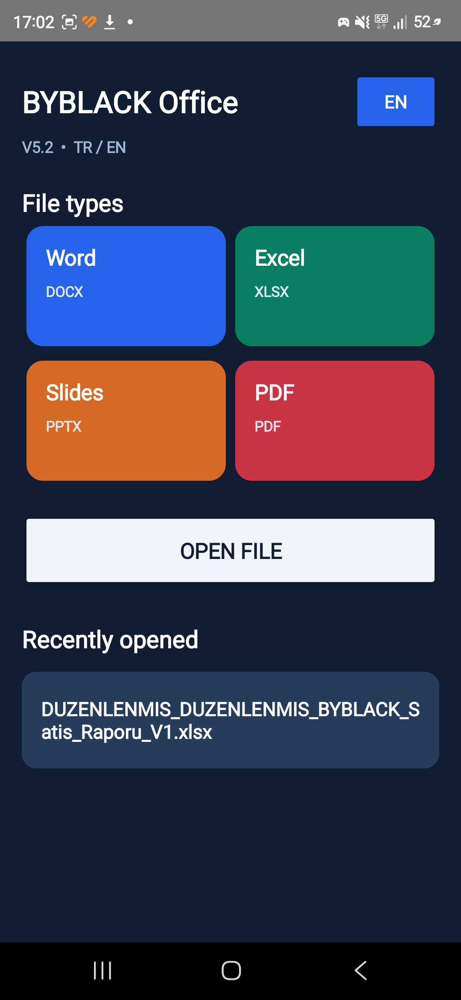

# BYBLACK Office — Android Office Project

**TR:** BYBLACK Office, Android telefon üzerinde **Termux** kullanılarak geliştirilen, belge açma ve düzenleme özellikleri hedefleyen deneysel bir Office uygulamasıdır. Proje halen **V5.3 Beta** aşamasındadır. Geliştirmeye katkıda bulunmak isteyen herkesi test etmeye ve geri bildirim paylaşmaya davet ediyoruz.

**EN:** BYBLACK Office is an experimental Android document app built on a phone using **Termux**. Version **V5.3 Beta** is available for testing. Contributors and testers are welcome!

## 📥 İndir / Download

**[BYBLACK Office V5.3 Beta APK](https://github.com/black1771/Byblack-Office/releases/tag/v5.3-beta)**

GitHub Releases sayfasında **Assets** bölümünden APK'yı indirip Android cihazına kurabilirsin. Bilinmeyen kaynaklardan yükleme izni gerekebilir. Yalnızca güvendiğin dosyaları yükle; önemli belgelerinin yedeğini al.

## 📱 Ekran görüntüsü / Screenshot

## 🛠️ Baştan sona neler yaptık?

1. **Android üzerinde geliştirme ortamı:** Termux, Java, Android SDK ve Gradle kullanmadan APK oluşturma yaklaşımıyla başladık.
2. **Belge motorları:** Excel için Apache POI, PDF metin işlemleri için PDFBox ve Android'in PDF sayfa görüntüleme altyapısı üzerinde çalıştık.
3. **Excel okuma sorunu:** Android'de XMLBeans kaynaklarının yüklenmesiyle ilgili hataları inceleyip uygulama paketindeki gerekli kaynakları düzenledik.
4. **Excel arayüzü:** Hücreleri tablo olarak gösterme, hücre seçme ve düzenleme alanı ekledik. Kaydetme ve farklı dosyalarda yeniden açma testleri sürüyor.
5. **Uygulama arayüzü:** Word, Excel, PowerPoint ve PDF bölümleri, son açılan dosya alanı, Türkçe/İngilizce seçeneği ve özel BYBLACK simgesi üzerinde çalıştık.
6. **PDF V5.3:** PDF sayfalarını gerçek sayfa görünümünde açma, üzerine yazı ekleme ve yeni PDF olarak kaydetme işlevleri için kod ekledik. Farklı PDF dosyalarıyla uçtan uca doğrulama henüz tamamlanmadı.
7. **ARM64 derleme sorunu:** Masaüstü x86_64 `aapt2` aracının Termux/ARM64 üzerinde çalışmaması sorununu, Termux uyumlu `aapt2` kullanarak aştık.
8. **GitHub yayını:** Java kaynaklarını, manifesti, simge kaynağını, ekran görüntüsünü, kurulum açıklamalarını ve V5.3 Beta APK'sını yayımladık.
9. **Kaynak koddan APK testi:** GitHub deposu telefonda klonlandı; yerel bağımlılıklarla yaklaşık **31 MB** APK oluşturuldu ve uygulamanın açıldığı doğrulandı.

## 🧪 Durum / Test status

| Özellik | Durum |
|---|---|
| Termux ARM64 üzerinde yerel kaynak derleme | Başarılı (geliştirme cihazında) |
| Derlenen APK'nın açılması | Başarılı (geliştirme cihazında) |
| Excel hücre değerinin ekranda değiştirilmesi | Önceki sürümde gözlemlendi |
| Excel dosyasının kaydedilip yeniden açılması | Daha fazla test gerekli |
| PDF sayfa görüntüleme | Kod eklendi; farklı dosyalarla test gerekli |
| PDF üzerine yazı ekleme ve kaydetme | Kod eklendi; uçtan uca test gerekli |
| Word / PowerPoint tam düzenleme | Henüz desteklendiği doğrulanmadı |
| Temiz Termux kurulumunda sıfırdan derleme | Henüz doğrulanmadı |

**Önemli:** Bu bir beta sürümdür; profesyonel Office uygulamalarının tüm özelliklerini sunduğu iddia edilmemektedir. PDF'nin görüntü olarak yeniden kaydedilmesi seçilebilir metin, bağlantı, form veya dijital imzaları kaybettirebilir.

## 🤝 Geliştiricilere ve kullanıcılara çağrı

**BYBLACK Office'i indirip deneyin ve birlikte geliştirelim!**

- Uygulamayı kurup farklı Android sürümlerinde test edin.
- PDF/Excel açma, düzenleme ve kaydetme sorunlarını örnek adımlarla bildirin.
- Arayüz, performans, erişilebilirlik ve TR/EN çeviriler için öneri paylaşın.
- Android, Java, Termux, PDF ve Excel alanlarında katkı sağlayabiliyorsanız çözüm önerileri veya pull request gönderin.
- Sorun bildirirken cihaz modeli, Android sürümü, uygulama sürümü, beklenen/gerçekleşen davranış ve mümkünse kişisel bilgi içermeyen ekran görüntüsü ekleyin.

**[Hata bildir / Report an issue](https://github.com/black1771/Byblack-Office/issues/new)** · **[Kaynak kod / Source](https://github.com/black1771/Byblack-Office)**

## 🔧 Kaynaktan derleme

[Kurulum ve derleme rehberi](INSTALL.md) · [Termux yerel derleme betiği](scripts/build-termux-local.sh)

Derleme betiği geliştirme telefonundaki önceden hazırlanmış Android SDK ve bağımlılıkları kullanır. **Temiz bir Termux ortamında tek komutla kurulumu henüz sağlamaz.** Bu da katkıya açık öncelikli işlerden biridir.

## 🗺️ Sonraki hedefler

PDF kaydetme/doğrulama testleri; Excel biçimlendirme ve güvenilir kaydetme; Word/PowerPoint desteğinin iyileştirilmesi; daha iyi arayüz; bağımlılıkların otomatik kurulumu; testler ve tekrarlanabilir derleme.

## 📜 Lisans

Proje kodu ve üçüncü taraf bağımlılıklarının lisans değerlendirmesi henüz tamamlanmadı. **Şu an bir açık kaynak lisansı verilmemiştir.** Kaynakların GitHub'da görünür olması otomatik olarak yeniden kullanım veya dağıtım izni vermez. Katkı yapmadan önce bu durumu dikkate alın.

---

**BYBLACK Office — Developed on Android with Termux.**  
GitHub: [@black1771](https://github.com/black1771)
